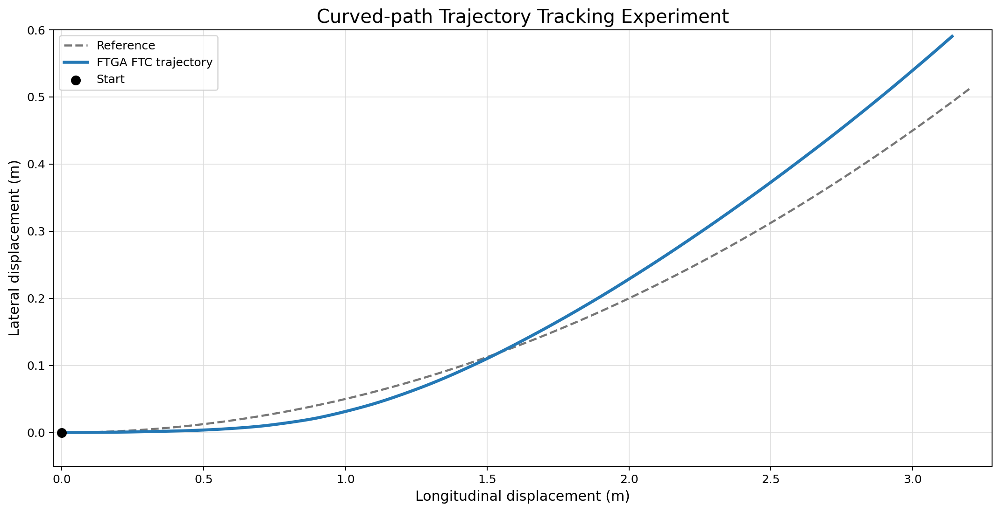
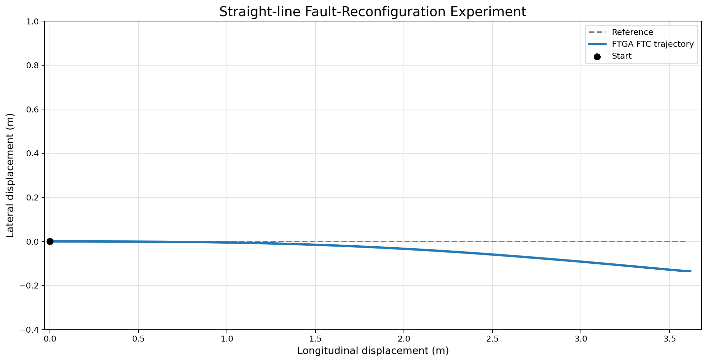

# WHEELTEC ROS 2 小车控制

这个项目用 ROS 2 Humble 控制 WHEELTEC Mini 4WD 小车，基于轮式里程计做直线和抛物线跟踪，并记录实车轨迹，用于比较参考路径与实际行驶路径。

控制节点从 `/odom` 读取位置和航向，通过 `/cmd_vel` 向 WHEELTEC 底盘发送线速度与角速度。直线和曲线实验以启用时的小车位置与朝向为局部原点，可以在没有 AMCL 和地图的情况下运行。

| 功能 | 启动文件 | 参考路径 |
| --- | --- | --- |
| 里程计直线跟踪 | `odom_line.launch.py` | 沿初始朝向前进 3.6 m |
| 直线故障实验 | `odom_line_fault.launch.py` | 同上，经过故障与补偿节点 |
| 曲线跟踪与故障实验 | `odom_curve_fault.launch.py` | `y = 0.05x²`，局部横坐标 `x` 从 0 到 3.2 m |
| 地图中的直线跟踪 | `map_line.launch.py` | 在 `map` 坐标系内跟踪配置的路径 |

故障实验使用 `/cmd_vel_nominal → /cmd_vel` 之间的速度指令转换来模拟左前电机效能衰减，并执行左右侧等效速度补偿。该实现工作在 ROS 2 速度接口层，实际轮速由底盘固件控制。控制律与论文的对应关系见[控制器说明](ftag_waypoint_controller/README.md)。

## 连接小车并运行

在已安装 ROS 2 Humble 和 WHEELTEC 底盘驱动的 Ubuntu 22.04 环境中，将本仓库克隆到 ROS 2 工作空间的 `src` 下。若已有同名包，工作空间中只保留一份。然后从工作空间根目录编译。

```bash
source /opt/ros/humble/setup.bash
rosdep install --from-paths src --ignore-src -r -y
colcon build --packages-select ftag_waypoint_controller --symlink-install
source install/setup.bash
```

先在小车上启动厂商底盘驱动。若厂商镜像提供以下启动文件，可在已加载工作空间环境的终端中运行。

```bash
ros2 launch turn_on_wheeltec_robot turn_on_wheeltec_robot.launch.py
```

确认 `ros2 topic hz /odom` 能收到里程计，停止键盘遥控和导航等其他速度发布节点。把小车放在开阔区域并摆正，再在另一终端启动实验。

```bash
ros2 launch ftag_waypoint_controller odom_curve_fault.launch.py
```

程序默认禁用运动和故障。确认周围净空并准备好停车后，在另一终端执行以下指令。仅测试曲线控制时，可保持 `fault_enabled` 为 `false`。

```bash
ros2 param set /front_left_fault_injector fault_enabled true
ros2 param set /odom_curve_controller enabled true
```

停车和复位时，先关闭运动，再关闭故障。

```bash
ros2 param set /odom_curve_controller enabled false
ros2 param set /front_left_fault_injector fault_enabled false
```

运行直线实验时，切换对应启动文件，并将运动控制节点换成 `/odom_line_controller`。

## 记录并绘制轨迹

运动前启动录包，停车后用 `Ctrl+C` 结束记录。录包可以在小车上运行，也可以在能收到同一 ROS 2 网络话题的虚拟机上运行。

```bash
ros2 bag record -o curve_run /odom /cmd_vel_nominal /cmd_vel_allocated /cmd_vel /fault/effectiveness
python3 plot_curve_trajectory.py --bag curve_run --output curve.png
```

仓库提供两组实车里程计导出的局部轨迹点。安装 NumPy 和 Matplotlib 后，可以直接用 TXT 生成图片，无需连接小车。

```bash
python3 plot_fault_trajectory.py --points examples/straight/trajectory_points.txt --output straight.png
python3 plot_curve_trajectory.py --points examples/curve/trajectory_points.txt --output curve.png
```

| 实车实验 | 样本数 | 最大偏差 |
| --- | ---: | ---: |
| 直线 | 949 | 13.40 cm |
| 抛物线 | 513 | 9.76 cm |

偏差取同一纵向位置的横向坐标差。曲线参考覆盖 3.2 m 的纵向范围，实测轨迹画到最后一帧有效里程计，约 3.139 m。示例的曲线参数快照位于 [examples/curve](examples/curve)。





项目代码采用 [Apache-2.0](LICENSE) 许可。WHEELTEC 底盘驱动和固件由厂商提供。
